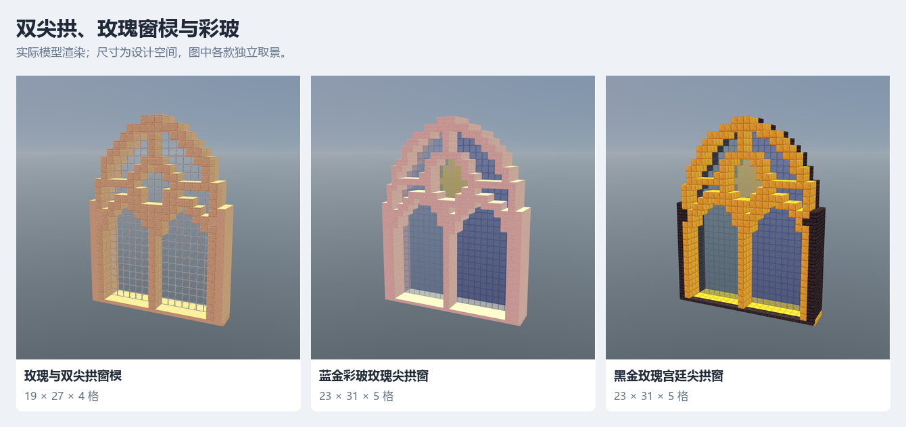
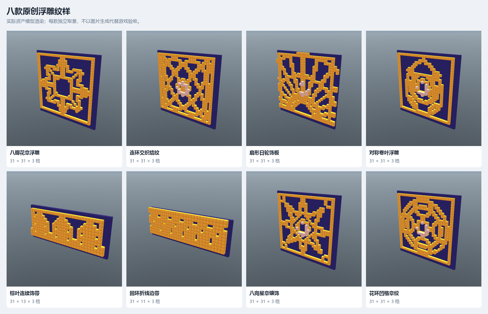

# 华丽建筑与陈设资产集

本批是宫廷金饰主题，由 Agent 辅助生成，包含实际模型和原创程序化纹样；不声称覆盖所有地域与时代风格。资产保持数据型，安装不会执行维护工具；渲染与代理看图检查不替代用户审批、游戏验收或承载计算。

## 内容与实际预览

- 11条花式窗框配方及11份对应构件：上下分格木窗、齿饰檐口、三角山花、圆拱、玫瑰窗棂和彩玻尖拱。
- 20份华丽构件：柱式、横索阶梯、檐梁、承托块、拱门、基座、栏片、墙饰、天花、镶嵌桌、高背长椅、书架、花器和灯具。加上窗框，覆盖现有16类构件。
- 8份原创 SVG/PNG 图源、8块背板浮雕、4块齐平镶地、2块顶部花章。图源作为参考附件，不登记为可安装类型。

保留65条迁入配方；本批新增56项可安装数据，当前共121项。构件标记为 pending_visual_review，recommended 仅表示作者推荐程度。

[全部花式窗框](previews/ornate-windows-v1/all-windows.png)



[建筑构件](previews/ornate-modules-v4/architectural.png) · [家具、花器与灯具](previews/ornate-modules-v4/furnishings.png) · [全部20款](previews/ornate-modules-v4/all-modules.png)



[齐平镶地](previews/ornate-patterns-v2/floor.png) · [顶部花章](previews/ornate-patterns-v2/ceiling.png)

预览目录保留实际 master JSON.GZ、冻结快照、相机、图片和渲染清单。修改几何后建立新证据版本，保留旧图。原创纹样图源位于 [pattern-masters](pattern-masters/)；没有从参考网站复制图像。12格微缩试作出现明显细节损失，未收录；上架纹样保留原尺寸规格，不通过降低质量门槛制造“通过”。

## 现实构造与取舍

木窗区分外框、上下窗扇、相接横档和分格条，参考 [Historic England 传统窗资料](https://historicengland.org.uk/images-books/publications/traditional-windows-care-repair-upgrading/heag039-traditional-windows-revfeb17/)。古典窗按线脚、齿饰、窗台和山花分层；尖拱与玫瑰窗棂参考 [V&A 的哥特式语汇说明](https://www.vam.ac.uk/articles/the-gothic-style-an-introduction)。这些是方块化适配，不是历史建筑复原或现实规范验算。

大型窗、柱式和31格纹样板面向较大立面、纪念性建筑或陈设；不能直接当作普通房间的默认尺度。镶地为平整单层，浮雕有完整背板，不称作透雕窗。花器使用修剪球冠，容器有重复金线。只有灯具使用发光方块；礼仪台阶保留已选横索式护栏，不把纹样覆到细杆或踏步状态上。

## 作者维护

在本资产仓库根目录执行。`--engine` 指向具备花式窗型的 NBTCreator Skill，使用其声明的 Python/Pillow/NumPy 和渲染依赖。仅索引检查不需要渲染依赖。作者环境缺依赖时，可用 `mise exec -- python -m pip install -r requirements-authoring.txt` 安装与引擎一致的作者依赖；安装资产不会自动运行此步骤。

```powershell
mise exec -- python tools/build_ornate_pack.py --engine ../NBTCreator/.agents/skills/minecraft-nbt-modeler
mise exec -- python tools/build_ornate_modules.py --engine ../NBTCreator/.agents/skills/minecraft-nbt-modeler --evidence-version 4
mise exec -- python tools/build_ornate_patterns.py --engine ../NBTCreator/.agents/skills/minecraft-nbt-modeler --evidence-version 2
mise run index
mise run check
```

生成命令用于首次作者制作。已有文件须显式使用 `--replace-draft`，仅用于尚未发布的此批资产；发布后必须提高库版本。已有渲染目录拒绝覆盖，重新出图另选证据版本。

```powershell
mise exec -- python tools/preview_ornate_windows.py --engine ../NBTCreator/.agents/skills/minecraft-nbt-modeler
mise exec -- python tools/preview_ornate_collection.py --engine ../NBTCreator/.agents/skills/minecraft-nbt-modeler --collection modules --evidence-version 4
mise exec -- python tools/preview_ornate_collection.py --engine ../NBTCreator/.agents/skills/minecraft-nbt-modeler --collection patterns --evidence-version 2
```

图册默认使用 Windows 微软雅黑，其他机器通过 `--font <CJK字体文件>` 和可选 `--font-bold <字体文件>` 指定已安装字体，不自动下载字体。渲染无头进行，不要求打开 Electron。

在相邻 NBTCreator 根目录运行：

```powershell
mise run modular:test
mise run ornate:test
mise run assets:sync -- --source ../NBTCreator-AssetLibrary
mise run assets:check
```

验证覆盖编译、包围范围、旋转/镜像、代表资产 SNBT 回读和数据不被修改；窗框额外验证窗格、退进、半格接触、玻璃局部移除及保留框体。链条、叶片、灯具和邻接更新仍需在目标游戏布局另验。资产协议不加载工具脚本或图源文件。

## 许可

新数据和原创图源沿用 LicenseRef-NBTCreator-Project，不擅自授予额外开源许可。预览来自本次资产的实际渲染，不重新分发游戏纹理包。现实建筑资料只用于识别构件关系，链接不表示复制了其图片或文稿。
